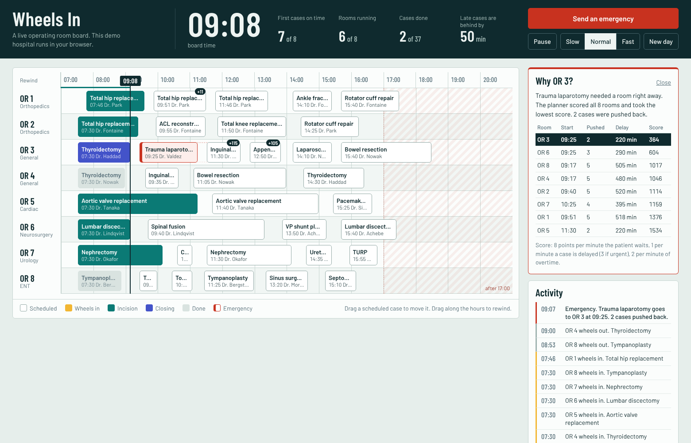
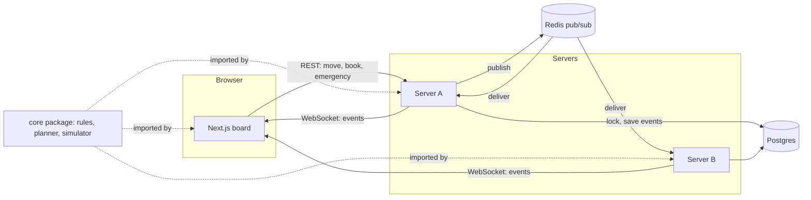

# Wheels In

A live operating room board. Think air traffic control, but for surgery.

**[Try the demo](https://julianmunozcarrera.github.io/wheels-in/)** (it runs a whole fake hospital inside your browser tab, no sign up)



"Wheels in" is the moment the patient rolls into the operating room. Hospitals track it for every case, because a late first case makes the whole day late.

I'm a computer science student on the pre-med track, and I wanted a project that sits right where those two meet. My other projects are machine learning. This one is the opposite: no models, just the kind of engineering that has to be correct when a lot of people touch the same thing at once.

## What it does

- **Shows every room live.** Eight operating rooms, about 36 cases a day. Each case moves through wheels in, incision, closing, wheels out. Every open screen updates right away (about 4 ms in my load test).
- **Never double books.** Two coordinators can drag cases into the same slot at the same instant. Exactly one wins. The other gets a clear message.
- **Handles the trauma bump.** Hit "Send an emergency" and a planner tries every room, works out who would get pushed, scores each choice, and takes the cheapest one. Then it shows you the score table so you can see why.
- **Ripples delays honestly.** If a surgery runs long, the next case in that room slides. If that surgeon was due in another room after lunch, that room slides too.
- **Rewinds time.** Drag along the hour ruler and the board replays the day up to that minute.
- **Runs a fake hospital.** A simulator plays out a full day with late starts, long cases and surprise emergencies, so the board is always alive. All patients and surgeons are made up.

## The three hard parts

### 1. No double bookings, even with many servers

There are two layers, on purpose.

**Layer one, the app.** Every write follows the same six steps ([`apps/server/src/board.ts`](apps/server/src/board.ts)):

1. Take a Postgres advisory lock, so writers go one at a time across all servers.
2. Catch up on any events another server saved since this one last looked.
3. Check the request against the rules. Each case has a version number, so a request made from an out of date screen is refused.
4. Save the new events.
5. Commit.
6. Publish the events on Redis so every server can push them to its browsers.

**Layer two, the database.** Even if the app had a bug, Postgres itself refuses the bad row ([`apps/server/db/schema.sql`](apps/server/db/schema.sql)):

```sql
CONSTRAINT one_case_per_room EXCLUDE USING gist
  (room_id WITH =, int4range(start_min, end_min) WITH &&)
```

That line says: no two rows may have the same room and overlapping times. There is a second one for surgeons. One of my tests skips the app completely and fires 30 raw inserts at the same slot. Exactly one gets in.

### 2. The bump planner

When an emergency arrives ([`packages/core/src/bump.ts`](packages/core/src/bump.ts)):

1. For each room, find the earliest moment the emergency could start. It can not interrupt a surgery that is already under way.
2. Drop it in and run **repair** ([`packages/core/src/repair.ts`](packages/core/src/repair.ts)). Repair uses a min heap to walk forward in time. It pushes each clashing case just far enough, then checks what that push hit, and so on. It follows surgeons across rooms.
3. Score the result: 8 points per minute the emergency patient waits, 1 per minute of delay to a normal case, 3 if the case is urgent, 2 per minute of staff overtime.
4. Lowest score wins.

Finding "what overlaps this time range" is done with an **interval tree** I wrote from scratch ([`packages/core/src/intervalTree.ts`](packages/core/src/intervalTree.ts)). It is a treap where each node remembers the latest end time below it, so whole branches can be skipped. A test checks it against the slow obvious method over 2000 random steps.

### 3. Time travel

The board is never updated in place. Every change is saved as an event in a list: "case booked", "case moved", "wheels in". The current board is just that list played from the top ([`packages/core/src/state.ts`](packages/core/src/state.ts)).

So to see 10:42, you play the list and stop at 10:42. That is the whole trick. It also gives a full audit trail for free, which matters in a hospital.

## How it fits together



The rules live in one package, `packages/core`, with no dependencies. The server imports it. The browser imports it too. That is why the demo can run the full hospital with no server at all, and why the browser can tell you a drop is invalid before you let go of the mouse.

Only one server runs the simulated clock at a time. They pick a leader with a Postgres lock. If the leader dies, its lock is released and another server takes over.

## Numbers

From `npm run loadtest` with everything on one 16 core Linux machine (two things to know: the load generator shared that machine, and the writers pick random slots, so most of their requests are supposed to be refused).

| What | Result |
| --- | --- |
| Browsers connected | 500 |
| Coordinators writing at once | 20 |
| Write requests in 15 seconds | 11,607 (774 per second) |
| Accepted | 363 |
| Refused by a rule | 11,244 |
| Server errors | 0 |
| Write latency | p50 20 ms, p95 61 ms, p99 89 ms |
| Messages delivered to browsers | 182,500 |
| Time from save to browser | p50 4 ms, p95 13 ms, p99 20 ms |
| **Double bookings** | **0** |

## Run it

You need Node 22.

**Just the demo (no database):**

```bash
npm install
npm run dev
```

Open http://localhost:3000. The hospital runs in your browser.

**The full stack:**

```bash
docker compose up --build
```

Open http://localhost:3000 in two tabs. This starts Postgres, Redis, two servers and the site. Drag a case in one tab and watch the other.

**The full stack without Docker:**

```bash
# needs Postgres 16 and Redis running locally
cp .env.example .env
export $(cat .env | grep -v '^#' | xargs)
npm run dev:server     # terminal 1
npm run dev            # terminal 2
```

## Tests

```bash
npm test
```

The core tests need nothing. The server tests need Postgres and Redis (see `.env.example`). CI runs both on every push.

Some of the tests I like most:

- 25 different simulated days, checked for overlaps all day long, and every day must finish.
- 100 people book the same slot through two servers. Exactly one succeeds.
- 300 random moves and emergencies thrown at two servers at once. Zero overlaps after.
- The `cases` table must exactly match what you get by replaying the events.
- Two servers both try to run the clock. Time must move at single speed, not double.

## Layout

```
packages/core   the rules: interval tree, repair, bump planner, simulator (no dependencies)
apps/server     Fastify, Postgres event log, Redis fan out, WebSockets
apps/web        Next.js board, also runs standalone as the demo
docs/DESIGN.md  why I made the choices I made, and what I would change
```

## What this is not

This is a simulation. It is not connected to any hospital and it has never seen real patient data. Real hospitals use tools like Epic OpTime for this, and the hard part there is integration, privacy law and getting people to change habits, not the scheduling code.

Known limits, on purpose for now:

- No login. Anyone with the link can move a case or start a new day.
- One board, one day at a time.
- When a case finishes early, later cases do not get pulled forward.
- Any room can take any emergency. A real planner would check equipment and staff.

More on these in [docs/DESIGN.md](docs/DESIGN.md).

## License

MIT
